# How to Open, Extract and Edit VPK Files

VPK (Valve Pak) is the archive format Source and Source 2 games pack their files into. Large packages are split into a `pak01_dir.vpk` index and numbered chunk files such as `pak01_000.vpk`. Source 2 Viewer can open, extract, create and edit them.

## Browsing VPK Archives

- Open a VPK with File > Open or from the Explorer. For a split package, open the `_dir.vpk`; its chunk files are read automatically.
- VPKs inside other VPKs, such as maps in workshop items, open directly.
- To check a package, right-click the root and select **Verify package contents**, or use `--vpk_verify`.

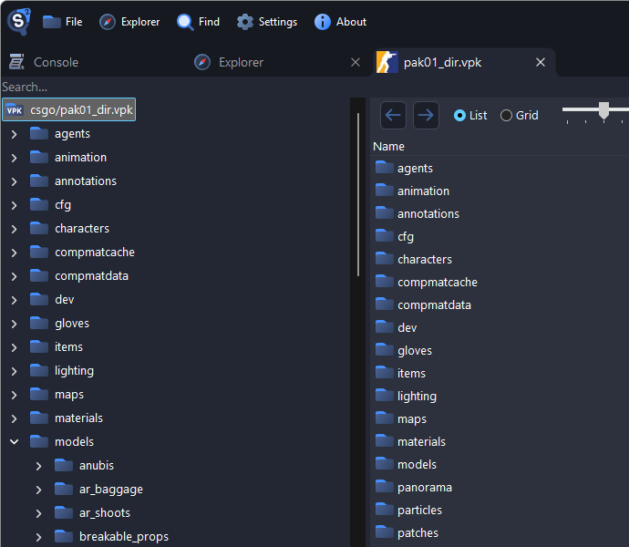

## Extracting Files

Right-click a file, a folder, or the root of the tree for the whole VPK, then choose:

- **Export as is** to save it unchanged
- **Decompile & export** to convert it to formats you can edit

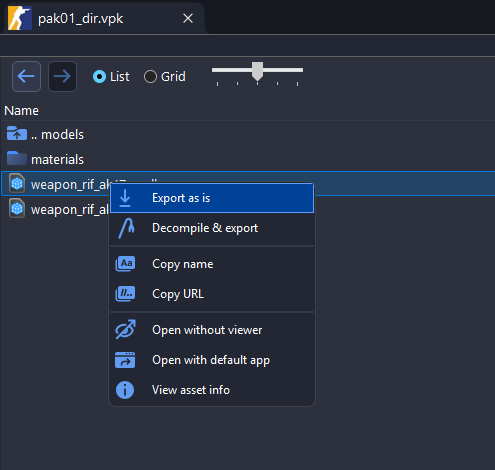

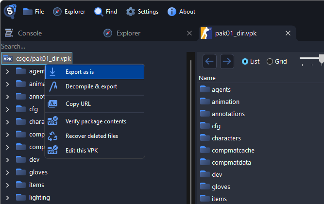

**Decompile & export** on a folder or the whole VPK first asks which format to use for each file type, see [Getting Started](./getting-started.md#batch-operations).

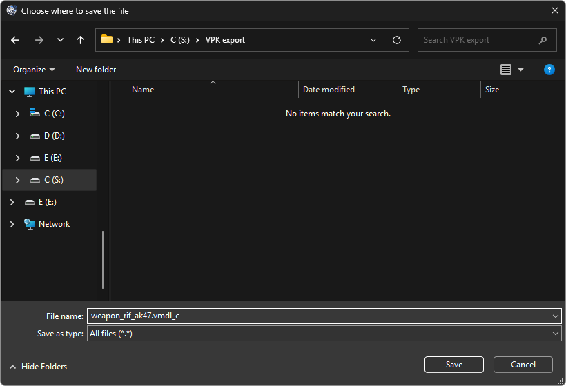

### Using the CLI

To extract a whole VPK from a script:

```sh
Source2Viewer-CLI -i "pak01_dir.vpk" -o "output_folder/"
```

Add `-d` to decompile the files:

```sh
Source2Viewer-CLI -i "pak01_dir.vpk" -o "output_folder/" -d
```

## Creating and Editing VPK Archives

1. In the **File** menu, choose:

    - **Create VPK** to start an empty VPK
    - **Create VPK from folder** to pack everything inside a folder
    - **Edit VPK** to change an existing VPK

    You can also right-click the root of an open VPK and select **Edit this VPK**.

    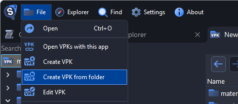

    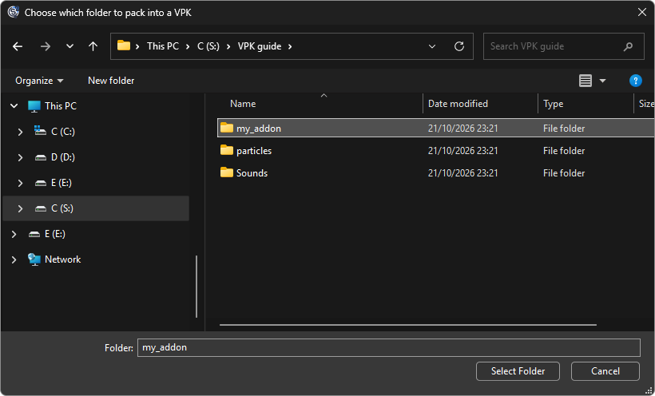

2. Right-click in the editing tab to add files and folders, create folders, or rename and remove them. Paths are lowercased.

    - **Add existing folder** adds the folder itself, and you can pick several.
    - If a file already exists, you choose to **Replace** or **Skip** it.
    - Empty folders are not saved.

    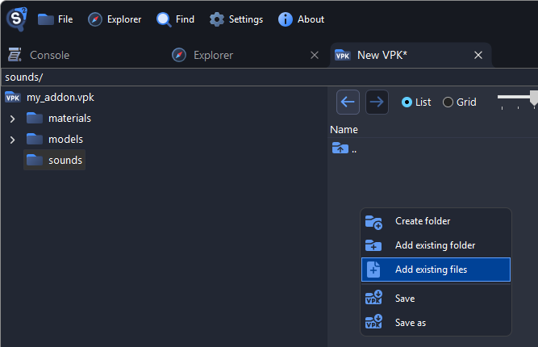

    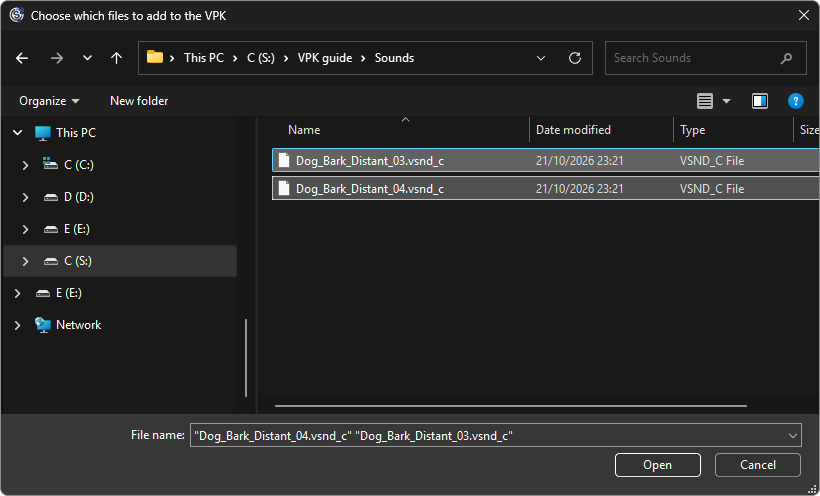

    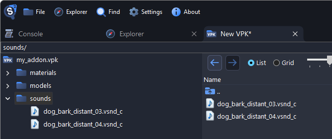

    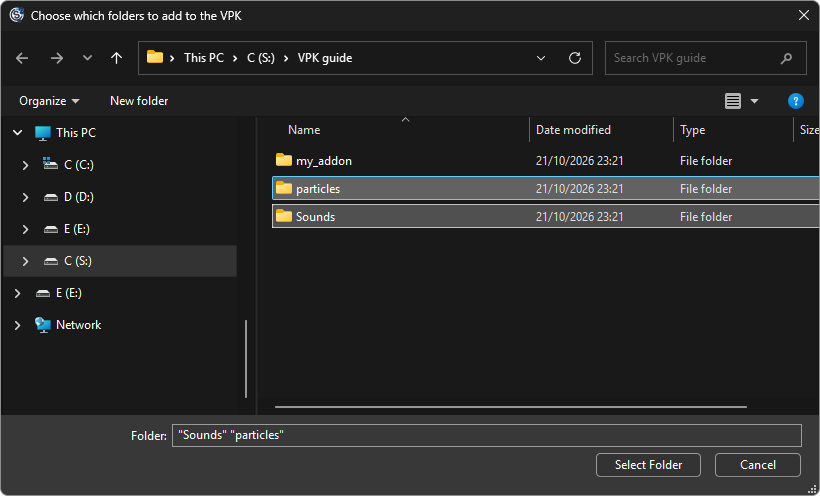

    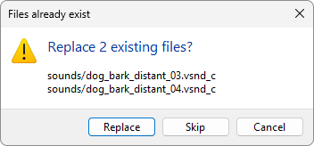

3. Press Ctrl+S, or right-click and select **Save** or **Save as**. Tabs with unsaved changes show `*` in their title. To split the VPK into chunk files, pick **Valve Pak split into chunk files** as the type and name it `*_dir.vpk`.

    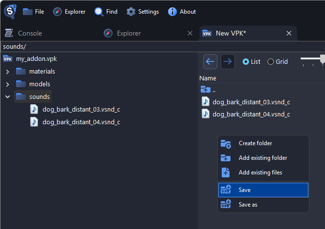

    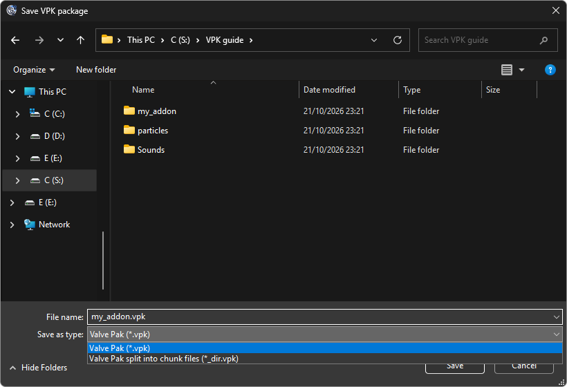

    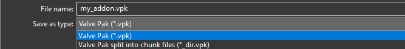

### Using the CLI

To pack a folder into a VPK from a script:

```sh
Source2Viewer-CLI -i "my_addon" --vpk_create "my_addon.vpk"
```

To split it into chunk files of 100 MiB, name it `*_dir.vpk`:

```sh
Source2Viewer-CLI -i "my_addon" --vpk_create "my_addon_dir.vpk" --vpk_create_chunk_size 100
```

See the [command-line utility](./command-line.md#create-a-vpk-from-a-folder) for more.

### Good to Know

- Saving removes the VPK's signature, so games that check signatures won't load it.
- A single-file VPK must stay under 2 GiB; save bigger ones split into chunk files.
- In a split VPK, added files go into chunk files right away and stay there even if you don't save.

## Recovering Deleted Files

Chunk files can still contain files that a game update removed or replaced. Recovering them lets you compare assets across updates.

1. Open a split package such as `pak01_dir.vpk`. Single-file VPKs don't have this option.
2. Right-click the root and select **Recover deleted files**.

    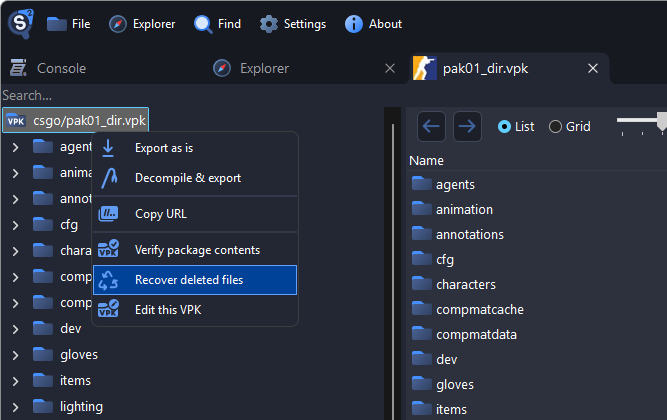

3. Recovered files appear under **Deleted files**; files whose names can't be guessed are under **Undetected filenames**.

    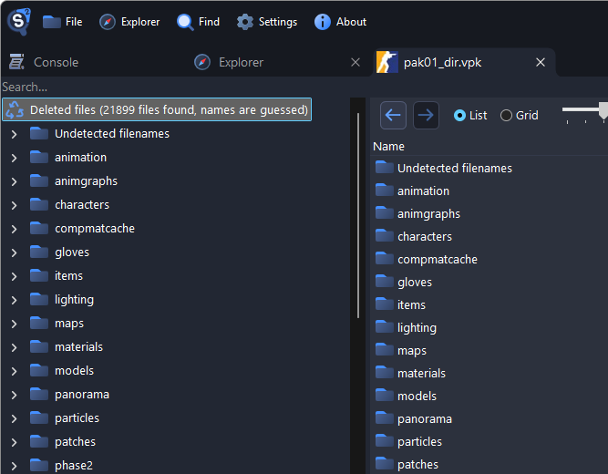

::: warning
Recovered files can be incomplete, corrupted or from older game versions.
:::

## VPK File Format

Source 2 Viewer uses the [ValvePak](https://www.nuget.org/packages/ValvePak/) library to read and write VPKs, which you can also use in your own programs. The [Source 2 Wiki](https://www.source2.wiki/FileFormats/vpk) describes the format in detail.
